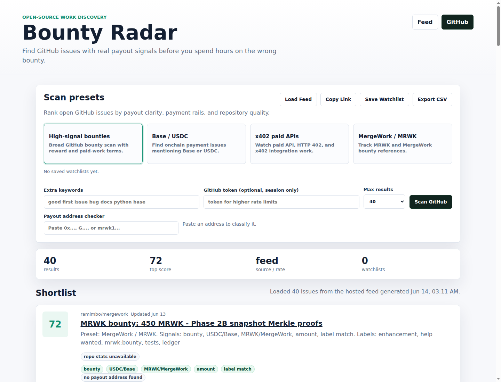

# Bounty Radar

[](https://github.com/go165/bounty-radar/actions/workflows/ci.yml)
[](https://github.com/go165/bounty-radar/actions/workflows/daily-feed.yml)
[](https://go165.github.io/bounty-radar/)
[](https://go165.github.io/bounty-radar/feed/latest.json)

**Find GitHub issues with real payout signals before you spend hours on the wrong bounty.**

Bounty Radar is a zero-backend dashboard for developers and agent builders who hunt paid open-source work. It opens with a hosted daily shortlist, can run fresh GitHub issue searches in the browser, scores payout credibility signals, highlights Base/USDC/x402/MergeWork keywords, extracts payout addresses, and exports a shortlist you can review before opening a PR.

The browser checker now includes payout lint warnings for common irreversible-payment mistakes such as malformed EVM addresses, zero addresses, bad EIP-55 checksums, non-checksummed EVM addresses, and USDC text without explicit chain context. Use [Payout Address Lint](https://github.com/go165/payout-address-lint) when you want the same idea as a reusable CLI or GitHub Action in a bounty repository.

Live demo: https://go165.github.io/bounty-radar/

Daily feed: https://go165.github.io/bounty-radar/feed/latest.json

Agent handoff: [docs/agent-handoff.md](docs/agent-handoff.md)

Paid alert API deployment guide: [docs/paid-alert-api.md](docs/paid-alert-api.md)



## Why This Exists

GitHub has many issues labeled `bounty`, `reward`, or `paid`, but the quality varies. Developers need to answer a few questions quickly:

- Is there an actual payment path, or only vague marketing copy?
- Does the issue mention USDC, Base, x402, MRWK, MergeWork, Gitcoin, TipLink, or another payout rail?
- Is there a visible payout address or claim process?
- Can I export a small list and inspect it before investing time?

Bounty Radar makes that triage fast without asking for your GitHub token by default.

## Features

- **Preset searches** for high-signal bounty issues, Base/USDC work, x402 paid APIs, and MergeWork/MRWK opportunities.
- **Live hosted shortlist** loaded from the daily JSON feed so the demo has useful results immediately.
- **Custom GitHub issue search** with optional minimum payout keyword filtering.
- **Payout signal score** based on title/body labels, payment rail terms, reward amounts, address hints, and payout lint risk.
- **Best-effort repository quality signals** for stars, forks, recent push activity, and archived status.
- **Saved watchlists** in local storage for repeated bounty scans.
- **Shareable search URLs** for posting a preset, keyword set, and result limit to relevant communities.
- **Daily JSON/CSV feed** generated by GitHub Actions for agents, dashboards, and alert pipelines.
- **Machine-readable feed manifest and JSON Schema** for automation that should validate the feed before consuming it.
- **Zero-dependency shortlist CLI** for coding agents and CI jobs that need Markdown, JSON, or CSV output from the hosted feed.
- **Paid alert API prototype** with a free preview route and a 402-style paid endpoint.
- **x402 paid API deployment guide** for turning the feed into an agent-readable paid alert API.
- **Address extraction and linting** for EVM `0x...`, Stellar `G...`, and MRWK `mrwk1...`-style addresses.
- **CSV export** for shortlists.
- **No backend**: runs as static HTML/CSS/JS on GitHub Pages.
- **Optional GitHub token** stored only in browser session storage for higher API rate limits.

## Quick Start

Open the hosted demo, or run locally:

```bash
git clone https://github.com/go165/bounty-radar.git
cd bounty-radar
python3 -m http.server 8080
```

Then open http://localhost:8080.

Try the hosted feed in 30 seconds:

```bash
npm test
npm run shortlist -- --min-score 50 --require-amount --require-rail --limit 10
node scripts/shortlist.mjs --feed https://go165.github.io/bounty-radar/feed/latest.json --preset x402 --format markdown
```

Run the agent-friendly shortlist CLI without installing runtime dependencies:

```bash
npm run shortlist -- --preset mergework --format json
npm run shortlist -- --feed feed/latest.json --signal 'x402|USDC|MRWK' --format csv
```

## Usage

1. Open the demo to see the latest hosted shortlist from `feed/latest.json`.
2. Pick a preset such as `Base / USDC` or `x402 paid APIs` for a fresh browser-side scan.
3. Add optional keywords like `good first issue`, `bug`, `docs`, or a specific ecosystem.
4. Click **Copy Link** to share the exact search, or **Scan GitHub** to run it.
5. Export CSV before deciding what to work on.

Example share URL:

```text
https://go165.github.io/bounty-radar/?preset=base-usdc&q=good%20first%20issue&limit=20
```

## Scoring Model

The score is intentionally simple and visible:

| Signal | Weight |
| --- | ---: |
| Payout keywords (`bounty`, `reward`, `paid`, `prize`) | +12 |
| Crypto rails (`USDC`, `Base`, `x402`, `MRWK`, `MergeWork`) | +18 |
| Amount-like text (`$250`, `100 USDC`, `500 MRWK`) | +16 |
| Payout address present | +20 |
| Issue labels include bounty/reward/help wanted | +8 |
| Repository quality: stars, forks, recent push activity | +3 to +15 |
| Stale issue penalty | -8 |

This is triage, not financial advice. Always inspect the issue, sponsor, repository history, and payout terms yourself.

Repository quality metadata is fetched sequentially and capped to avoid burning unauthenticated GitHub API limits. Add a token for higher limits when scanning large result sets.

## Opportunity Assessment

- **TAM / audience**: independent developers, agent builders, open-source maintainers, and onchain bounty operators who need faster paid-work discovery.
- **Differentiation**: GitHub-native bounty triage focused on payout credibility, not another generic issue search or closed marketplace.
- **Star-worthy hook**: a static, inspectable tool that developers can bookmark, run locally, and extend with their own bounty rails.
- **Monetization path**: hosted alerts, JSON feeds, webhooks, and x402-paid API access for teams and autonomous coding agents.
- **7-day demo feasibility**: the browser demo is already live; the next compounding features are daily digests, validators, and shareable feeds.

## 7-Day Roadmap

- Day 1: Static dashboard, presets, scoring, CSV export. Shipped.
- Day 2: Add saved watchlists in local storage. Shipped.
- Day 3: Add GitHub repo reputation panel: stars, forks, and activity signals. Shipped.
- Day 4: Add shareable preset URLs for launch posts and community review. Shipped.
- Day 5: Add GitHub Actions daily digest mode. Shipped.
- Day 6: Add hosted JSON/CSV feed for agents and dashboards. Shipped.
- Day 6.5: Auto-load the hosted feed into the demo so visitors see real current opportunities immediately. Shipped.
- Day 7: Ship API/webhook plan for paid alerts. Shipped as `examples/paid-alert-api`.

## Monetization Path

- Free static dashboard for discovery.
- Paid hosted alerts for teams and agents.
- API endpoint for `new high-signal bounty` feeds.
- Shortlist CLI and JSON feed that can be wrapped by coding agents, CI jobs, or paid x402 endpoints.
- Sponsored but clearly labeled bounty listings.
- Optional x402-paid export endpoints for machine agents.

## Daily Feed

The scheduled feed is generated from the same public GitHub issue signals as the UI:

- JSON: https://go165.github.io/bounty-radar/feed/latest.json
- CSV: https://go165.github.io/bounty-radar/feed/latest.csv
- Manifest: https://go165.github.io/bounty-radar/feed/manifest.json
- Schema: https://go165.github.io/bounty-radar/feed/schema.json

Agents and dashboards can start from the [agent handoff guide](docs/agent-handoff.md) for endpoint contracts, a minimal consumer, and review rules.

Use [examples/github-action-digest.yml](examples/github-action-digest.yml) to post a filtered bounty shortlist to a GitHub Actions job summary on a schedule or manual dispatch.

Use the included CLI when an agent or CI job needs a filtered shortlist instead
of the full feed:

```bash
npm run shortlist -- --min-score 50 --require-amount --require-rail --format markdown
npm run shortlist -- --feed https://go165.github.io/bounty-radar/feed/latest.json --preset x402 --limit 5 --format json
```

Regenerate the feed locally with a GitHub token for higher API limits:

```bash
GITHUB_TOKEN=your_token node scripts/build-feed.mjs
```

## Paid Alert API Prototype

The `examples/paid-alert-api` server shows how the hosted feed can become a paid alert surface for agents or dashboards. It exposes a free preview route and a 402-style paid route that can later be wired to a real x402 facilitator verifier.

```bash
node examples/paid-alert-api/server.mjs
curl 'http://localhost:8787/v1/alerts?min_score=40&limit=5'
curl -i 'http://localhost:8787/v1/paid/alerts?min_score=40'
curl -H 'X-Payment: demo-paid' 'http://localhost:8787/v1/paid/alerts?min_score=40'
```

For the full deployment path using `x402-paid-api-starter`, Cloudflare Workers, or official `@x402/express` middleware, see [docs/paid-alert-api.md](docs/paid-alert-api.md).

## Legal and Ethical Publishing Checklist

- Do not buy stars, trade stars, use fake accounts, spam comments, or mass-DM developers.
- Publish only in relevant communities: Show HN, x402/Base developer channels, GitHub bounty communities, and project Discords where tool sharing is allowed.
- Be transparent that the scoring is heuristic and requires manual verification.
- Do not claim a bounty is guaranteed unless the linked issue states payout terms clearly.

## Contributing

Contributions are welcome when they improve real payout discovery or make the scoring model easier to inspect. Start with [CONTRIBUTING.md](CONTRIBUTING.md) and include public evidence for new payout rails, presets, or scoring signals.

## Suggested Launch Posts

Short version:

> I built Bounty Radar, a static GitHub Pages tool that searches GitHub bounty issues and scores payout signals like USDC/Base/x402/MRWK keywords, amount text, and payout addresses. No backend, optional GitHub token only in session storage. Feedback welcome: https://go165.github.io/bounty-radar/

Long version:

> Developers waste time on vague bounty issues. Bounty Radar helps shortlist GitHub issues with clearer payout signals, export CSV, and inspect address/payment hints before starting work. It is open source and runs entirely in the browser.

## License

MIT
